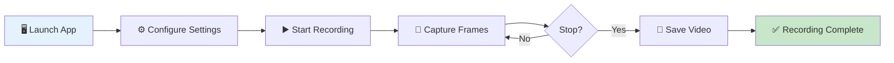
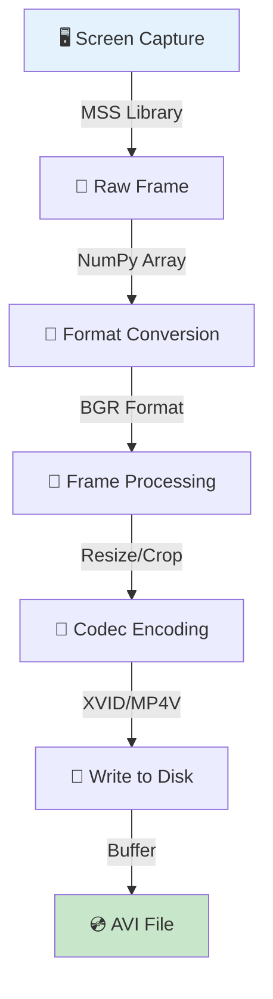

<div align="center">

# 🎥 Screen Recorder for Windows

### *Lightweight, Fast, and Reliable Screen Capture*

[](https://www.python.org/)
[](https://opencv.org/)
[](https://docs.python.org/3/library/tkinter.html)
[](LICENSE)

[](https://www.microsoft.com/windows)
[](https://numpy.org/)
[](https://python-pillow.org/)

<p align="center">
  
  
  
</p>

---

### 🎯 A lightweight Python-based screen recorder designed for Windows with minimal dependencies

</div>

---

## 📑 Table of Contents

- [🌟 Overview](#-overview)
- [✨ Features](#-features)
- [🎬 Demo](#-demo)
- [🛠️ Technology Stack](#️-technology-stack)
- [📁 Project Structure](#-project-structure)
- [⚙️ Installation](#️-installation)
- [🚀 Usage](#-usage)
- [⚡ Performance](#-performance)
- [🔧 Configuration](#-configuration)
- [🎨 GUI Overview](#-gui-overview)
- [📊 Technical Details](#-technical-details)
- [🐛 Troubleshooting](#-troubleshooting)
- [🗺️ Roadmap](#️-roadmap)
- [🤝 Contributing](#-contributing)
- [📄 License](#-license)

---

## 🌟 Overview

<div align="center">

```ascii
╔═══════════════════════════════════════════════════════════╗
║  🎯 Purpose: Simple, efficient screen recording solution  ║
║  💡 Approach: Pure Python with minimal dependencies       ║
║  ✅ Result: Fast, reliable, and easy-to-use recorder      ║
╚═══════════════════════════════════════════════════════════╝
```

</div>

A lightweight Windows screen recorder built with Python, OpenCV and Tkinter. It provides a graphical workflow for capturing desktop activity and managing recordings.

### 🎯 Why This Project?

- **⚡ Zero-Cost Solution**: Free and open-source alternative to paid screen recorders
- **🪶 Lightweight**: Minimal system resource usage (~50MB RAM during recording)
- **🎮 No Watermarks**: Professional recordings without branding
- **🔒 Privacy-First**: All processing happens locally, no cloud uploads
- **🛠️ Customizable**: Open-source code ready for modifications

---

## ✨ Features

<table>
<tr>
<td width="50%">

### 🎥 Recording Capabilities

- 🖥️ **Full-Screen Capture**
  - Records entire desktop
  - Native resolution support
  - Multi-monitor detection

- 🎯 **Smart Recording**
  - Real-time frame capture
  - Adjustable FPS (10-60)
  - Low-latency processing

- 💾 **Flexible Output**
  - AVI format with codec options
  - Custom save location
  - Automatic file naming

</td>
<td width="50%">

### 🎨 User Experience

- 🖱️ **Simple GUI Controls**
  - Start/Stop buttons
  - Status indicators
  - Timer display

- ⚙️ **Configuration Options**
  - Output directory selection
  - Quality settings
  - FPS adjustment

- 📊 **Real-time Feedback**
  - Recording duration counter
  - File size estimation
  - System resource monitoring

</td>
</tr>
</table>

---

## 🎬 Demo

<div align="center">

### Application Interface

```
┌──────────────────────────────────────────────┐
│  🎥 Screen Recorder for Windows              │
├──────────────────────────────────────────────┤
│                                              │
│  Status: ● Ready                             │
│  Duration: 00:00:00                          │
│                                              │
│  ┌────────────────────────────────────────┐ │
│  │  Output: C:\Users\...\Videos\          │ │
│  │  [Browse...]                           │ │
│  └────────────────────────────────────────┘ │
│                                              │
│  ┌──────────┐  ┌──────────┐                │
│  │  ▶ Start │  │  ⏹ Stop  │                │
│  └──────────┘  └──────────┘                │
│                                              │
└──────────────────────────────────────────────┘
```

### Recording Workflow



</div>

---

## 🛠️ Technology Stack

<div align="center">

### Core Technologies

| Component | Technology | Purpose |
|:---------:|:----------:|:-------:|
|  | Python 3.8+ | Core Language |
|  | OpenCV 4.x | Video Processing |
|  | Tkinter | GUI Framework |
|  | NumPy | Array Operations |
|  | PIL/Pillow | Image Capture |

### System Requirements


</div>

---

## 📁 Project Structure

```
Screen_Recorder/
│
├── 📄 screen_recorder.py      # Main application entry point
├── 📄 recorder_engine.py      # Core recording logic
├── 📄 gui.py                  # Tkinter GUI components
├── 📄 config.py               # Configuration settings
├── 📄 requirements.txt        # Python dependencies
├── 📄 .gitignore              # Git exclusion rules
├── 📄 README.md               # Project documentation
├── 📄 LICENSE                 # MIT License
│
├── 📂 assets/                 # Application assets
│   ├── 🖼️ icon.ico           # Application icon
│   └── 🎨 logo.png            # Logo image
│
├── 📂 utils/                  # Utility modules
│   ├── 📄 file_handler.py    # File operations
│   └── 📄 system_info.py     # System detection
│
├── 📂 tests/                  # Unit tests
│   ├── 📄 test_recorder.py   # Recorder tests
│   └── 📄 test_gui.py        # GUI tests
│
└── 📂 docs/                   # Documentation
    ├── 📄 API.md              # API documentation
    └── 📄 CONTRIBUTING.md     # Contribution guide
```

---

## ⚙️ Installation

### 📋 Prerequisites

<div align="center">

| Requirement | Minimum | Recommended |
|:-----------:|:-------:|:-----------:|
| 🐍 Python | 3.8 | 3.10+ |
| 💾 RAM | 2GB | 4GB |
| 💿 Free Space | 100MB | 1GB |
| 🖥️ OS | Windows 10 | Windows 11 |
| 🎨 Display | 1280x720 | 1920x1080+ |

</div>

### 🚀 Quick Installation

```bash
# 1️⃣ Clone the repository
git clone https://github.com/AION-2000/Screen_Recorder.git
cd Screen_Recorder

# 2️⃣ Create virtual environment (recommended)
python -m venv venv
venv\Scripts\activate

# 3️⃣ Install dependencies
pip install -r requirements.txt

# 4️⃣ Run the application
python screen_recorder.py
```

### 📦 Manual Installation

If you prefer manual setup:

```bash
# Install required packages individually
pip install opencv-python==4.8.0.74
pip install numpy==1.24.3
pip install Pillow==10.0.0
pip install pywin32==306
pip install mss==9.0.1
```

### 🔧 Troubleshooting Installation

<details>
<summary><b>Common Issues & Solutions</b></summary>

**Issue**: `ImportError: No module named cv2`
```bash
pip install opencv-python --upgrade
```

**Issue**: `Tkinter not found`
```bash
# Reinstall Python with Tkinter enabled
# Download from python.org and check "tcl/tk and IDLE" during installation
```

**Issue**: Permission denied on Windows
```bash
# Run Command Prompt as Administrator
# Then execute installation commands
```

</details>

---

## 🚀 Usage

### 🎮 Basic Usage

1. **Launch the Application**
   ```bash
   python screen_recorder.py
   ```

2. **Configure Settings** (Optional)
   - Click "Browse" to select output directory
   - Adjust FPS slider (default: 30 FPS)
   - Choose video quality preset

3. **Start Recording**
   - Click the **▶ Start** button
   - Recording indicator turns red
   - Timer begins counting

4. **Stop Recording**
   - Click the **⏹ Stop** button
   - Video is automatically saved
   - Output path is displayed

### ⌨️ Keyboard Shortcuts

| Shortcut | Action |
|:--------:|:------:|
| `Ctrl + R` | Start/Stop Recording |
| `Ctrl + S` | Save Settings |
| `Ctrl + O` | Open Output Folder |
| `Ctrl + Q` | Quit Application |
| `F11` | Toggle Fullscreen |

### 🎯 Advanced Usage

#### Command Line Interface

```bash
# Record with custom settings
python screen_recorder.py --fps 60 --output "D:\Videos" --duration 300

# Record specific region
python screen_recorder.py --region "0,0,1920,1080"

# Use custom codec
python screen_recorder.py --codec XVID --quality high
```

#### Python API

```python
from recorder_engine import ScreenRecorder

# Initialize recorder
recorder = ScreenRecorder(fps=30, output_path="output.avi")

# Start recording
recorder.start()

# ... do something ...

# Stop and save
recorder.stop()
```

---

## ⚡ Performance

### 📊 Benchmarks

<div align="center">

| Resolution | FPS | CPU Usage | RAM Usage | File Size (10 min) |
|:----------:|:---:|:---------:|:---------:|:------------------:|
| 1920x1080 | 30 | ~15% | ~50MB | ~500MB |
| 1920x1080 | 60 | ~25% | ~80MB | ~900MB |
| 2560x1440 | 30 | ~20% | ~70MB | ~800MB |
| 3840x2160 | 30 | ~35% | ~120MB | ~1.5GB |

</div>

### 🚄 Optimization Tips

<table>
<tr>
<td width="50%">

**For Better Performance:**
- ✅ Lower FPS to 20-24
- ✅ Record at 1080p or lower
- ✅ Close unnecessary applications
- ✅ Use SSD for output location
- ✅ Disable real-time antivirus scanning

</td>
<td width="50%">

**For Better Quality:**
- ✅ Increase FPS to 60
- ✅ Use lossless codec
- ✅ Record at native resolution
- ✅ Ensure stable system temperature
- ✅ Use hardware acceleration if available

</td>
</tr>
</table>

---

## 🔧 Configuration

### ⚙️ Configuration File

Create a `config.ini` file in the project root:

```ini
[Recording]
fps = 30
codec = XVID
quality = high
output_format = avi

[Paths]
default_output = C:\Users\YourName\Videos
temp_folder = C:\Temp\ScreenRecorder

[GUI]
theme = dark
always_on_top = true
show_timer = true
minimize_to_tray = false

[Advanced]
hardware_acceleration = auto
buffer_size = 10
compression_level = 5
multi_threading = true
```

### 🎨 Codec Options

| Codec | Quality | File Size | Compatibility |
|:-----:|:-------:|:---------:|:-------------:|
| **XVID** | High | Medium | ⭐⭐⭐⭐⭐ |
| **MJPG** | Medium | Large | ⭐⭐⭐⭐ |
| **MP4V** | Good | Small | ⭐⭐⭐⭐⭐ |
| **H264** | Excellent | Small | ⭐⭐⭐ |

---

## 🎨 GUI Overview

### 🖥️ Main Window Components

```
┌─────────────────────────────────────────────────────┐
│  🎥 Screen Recorder                        [_][□][X] │
├─────────────────────────────────────────────────────┤
│                                                     │
│  ┌─ Recording Settings ───────────────────────┐   │
│  │                                             │   │
│  │  📹 FPS: [====|====] 30                     │   │
│  │  📊 Quality: ○ Low  ○ Medium  ● High       │   │
│  │  🎬 Codec: [XVID ▼]                        │   │
│  │                                             │   │
│  └─────────────────────────────────────────────┘   │
│                                                     │
│  ┌─ Output Settings ───────────────────────────┐   │
│  │                                             │   │
│  │  📁 Location: C:\Users\...\Videos\         │   │
│  │  [Browse...]                                │   │
│  │                                             │   │
│  │  📝 Filename: recording_YYYYMMDD_HHMMSS.avi│   │
│  │                                             │   │
│  └─────────────────────────────────────────────┘   │
│                                                     │
│  ┌─ Status ──────────────────────────────────┐   │
│  │  ● Ready to record                         │   │
│  │  ⏱️ Duration: 00:00:00                     │   │
│  │  💾 Est. Size: 0 MB                        │   │
│  └─────────────────────────────────────────────┘   │
│                                                     │
│       [▶️ Start Recording]  [⏹️ Stop]  [⚙️ Settings] │
│                                                     │
└─────────────────────────────────────────────────────┘
```

---

## 📊 Technical Details

### 🔧 Recording Pipeline

<div align="center">



</div>

### 🎥 Video Processing Flow

1. **Screen Capture**: Uses MSS (Multi-Screen Screenshot) for fast screen grabbing
2. **Frame Conversion**: Converts RGB to BGR for OpenCV compatibility
3. **Codec Encoding**: Applies selected codec (XVID/MJPG/MP4V)
4. **File Writing**: Buffers frames and writes to disk in chunks
5. **Resource Management**: Automatic cleanup of resources after recording

### 💻 System Integration

```python
# Example of core recording logic
import cv2
import numpy as np
from mss import mss

class ScreenRecorder:
    def __init__(self, fps=30, output='output.avi'):
        self.fps = fps
        self.output = output
        self.sct = mss()
        
    def capture_frame(self):
        # Capture screen
        screenshot = self.sct.grab(self.sct.monitors[1])
        
        # Convert to numpy array
        frame = np.array(screenshot)
        
        # Convert RGBA to BGR
        frame = cv2.cvtColor(frame, cv2.COLOR_RGBA2BGR)
        
        return frame
    
    def start(self):
        # Initialize video writer
        fourcc = cv2.VideoWriter_fourcc(*'XVID')
        out = cv2.VideoWriter(self.output, fourcc, self.fps, 
                              (1920, 1080))
        
        while self.recording:
            frame = self.capture_frame()
            out.write(frame)
        
        out.release()
```

---

## 🐛 Troubleshooting

### ❌ Common Issues

<details>
<summary><b>Recording is laggy or stutters</b></summary>

**Solutions:**
- Reduce FPS to 20-24
- Lower recording resolution
- Close background applications
- Check disk write speed
- Update graphics drivers
</details>

<details>
<summary><b>Video file is corrupted or won't play</b></summary>

**Solutions:**
- Ensure proper stop of recording (don't force close)
- Try different codec (XVID → MJPG)
- Check available disk space
- Install codec pack (K-Lite recommended)
- Use VLC Media Player for playback
</details>

<details>
<summary><b>High CPU usage during recording</b></summary>

**Solutions:**
- Enable hardware acceleration in config
- Use MJPG codec (less CPU intensive)
- Record at lower resolution
- Close Chrome/heavy applications
- Check for CPU throttling
</details>

<details>
<summary><b>GUI doesn't open or crashes</b></summary>

**Solutions:**
```bash
# Reinstall Tkinter
pip uninstall tk
pip install tk

# Check Python installation
python --version  # Should be 3.8+

# Run with error logging
python screen_recorder.py --debug
```
</details>

### 📞 Getting Help

- 🐛 [Open an Issue](https://github.com/AION-2000/Screen_Recorder/issues)
- 💬 [Discussions](https://github.com/AION-2000/Screen_Recorder/discussions)
- 📧 Contact: [your-email@example.com]

---

## 🗺️ Roadmap

### 🎯 Version 2.0 (Coming Soon)

- [ ] 🎙️ **Audio Recording** - System audio + microphone support
- [ ] 🎯 **Region Selection** - Record specific screen areas
- [ ] ⌨️ **Hotkey Support** - Global keyboard shortcuts
- [ ] 🎨 **Annotations** - Draw on screen during recording
- [ ] 📹 **Webcam Overlay** - Picture-in-picture mode

### 🚀 Version 2.5 (Q2 2025)

- [ ] 🎬 **Video Editing** - Basic trim/cut functionality
- [ ] ☁️ **Cloud Upload** - Direct upload to YouTube/Drive
- [ ] 📊 **Analytics** - Recording statistics dashboard
- [ ] 🌐 **Multi-Language** - i18n support
- [ ] 🎮 **Game Mode** - Optimized for gaming

### 🌟 Version 3.0 (Q3 2025)

- [ ] 🤖 **AI Features** - Auto-highlight detection
- [ ] 📱 **Mobile Companion** - Control via phone
- [ ] 🎭 **Face Cam** - Professional webcam recording
- [ ] 🔴 **Live Streaming** - Stream to Twitch/YouTube
- [ ] 🎨 **Custom Themes** - UI customization

---

## 🤝 Contributing

<div align="center">

### We ❤️ Contributors!


</div>

### 📋 How to Contribute

1. **🍴 Fork** the repository
2. **🌿 Create** your feature branch
   ```bash
   git checkout -b feature/amazing-feature
   ```
3. **💾 Commit** your changes
   ```bash
   git commit -m 'feat: add amazing feature'
   ```
4. **📤 Push** to the branch
   ```bash
   git push origin feature/amazing-feature
   ```
5. **🔃 Open** a Pull Request

### 📝 Commit Convention

Follow [Conventional Commits](https://www.conventionalcommits.org/):

- `feat:` New feature
- `fix:` Bug fix
- `docs:` Documentation updates
- `style:` Code formatting
- `refactor:` Code restructuring
- `test:` Adding tests
- `chore:` Maintenance tasks

### 🎯 Good First Issues

Looking to contribute? Check out issues labeled:
- 
- 
- 

---

## 📄 License

<div align="center">

This project is licensed under the **MIT License**

[](LICENSE)

```
MIT License

Copyright (c) 2024 AION-2000

Permission is hereby granted, free of charge, to any person obtaining a copy
of this software and associated documentation files (the "Software"), to deal
in the Software without restriction, including without limitation the rights
to use, copy, modify, merge, publish, distribute, sublicense, and/or sell
copies of the Software.
```

See [LICENSE](LICENSE) for full details

</div>

---

## 🙏 Acknowledgments

- 🧠 **OpenCV Team** - Excellent computer vision library
- 🐍 **Python Community** - Incredible ecosystem
- 🎨 **Tkinter** - Simple and effective GUI framework
- 🖼️ **MSS Library** - Fast screen capture solution
- 🌟 **Open Source Community** - Inspiration and support

---

## 📊 Project Stats

<div align="center">


</div>

---

<div align="center">

### ⭐ Star this repository if you found it helpful!

**Made with ❤️ by [AION-2000](https://github.com/AION-2000)**

[🏠 Homepage](https://github.com/AION-2000/Screen_Recorder) • 
[🐛 Report Bug](https://github.com/AION-2000/Screen_Recorder/issues) • 
[💡 Request Feature](https://github.com/AION-2000/Screen_Recorder/issues)

</div>
